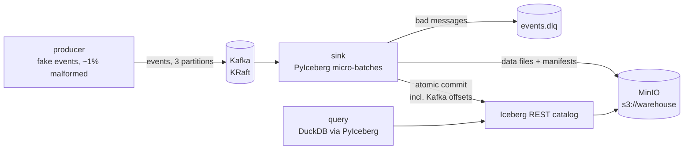

# kafka-iceberg-minio

An experiment with Apache Iceberg: a small, fully local streaming pipeline (**Kafka → PyIceberg → Iceberg tables on MinIO**), with exactly-once delivery into the table, a dead-letter topic, and a crash test you can run yourself.



## Run it

Needs Docker (Docker Desktop on Windows/macOS) and about 3 GB of free RAM.

```bash
docker compose up -d --build
docker compose logs -f sink          # wait for "committed N rows ... -> snapshot ..."
docker compose run --rm query        # row counts, partitions, snapshots, duplicate check
```

Where to look:

| What | Where |
|---|---|
| Files in object storage | MinIO console at http://localhost:9001 (`admin` / `password`) → `warehouse/demo/events/` |
| Catalog | http://localhost:8181/v1/namespaces/demo/tables/events |
| Kafka from your host | `localhost:29092` |

Tear down (deletes everything): `docker compose down -v`

## The crash test

This is the point of the project. Kill the sink with SIGKILL in the middle of a batch, so it gets no chance to clean up, then bring it back:

```bash
docker compose kill -s SIGKILL sink
docker compose start sink
docker compose logs --tail=20 sink   # "assigned {0: 1234, 1: ...}": resumed from the table's offsets
docker compose run --rm query        # "duplicate (partition, offset) pairs: 0"
```

Repeat it as often as you like. The `query` script exits non-zero if it finds a duplicate, and CI runs the same kill-and-restart sequence on every push.

## Design decisions

**Kafka offsets are stored in the Iceberg snapshot, not in Kafka.**
Each micro-batch is appended in a single Iceberg commit, and that commit's snapshot summary carries `kafka.offsets = {"events": {"0": 1234, "1": ...}}`. Committing data and offsets atomically leaves only two outcomes: the batch landed together with its offsets, or neither did. On startup (and on every partition assignment) the sink walks the snapshots from newest to oldest, finds the latest offsets and seeks to them. Kafka's consumer-group offsets are still updated afterwards, but only so `kafka-consumer-groups.sh --describe` shows lag. They're never used to resume. This is the same idea the official Iceberg Kafka Connect sink uses.

**If a commit fails, the sink crashes.**
If an Iceberg commit fails for any reason, the process exits and Docker restarts it. That includes the awkward case where the commit may have succeeded but the response was lost. Retrying in-process would mean guessing whether the commit went through. Restarting re-reads the truth from the table instead, and the atomic commit makes that always correct.

**The walk-back skips snapshots without offsets.**
A compaction job or a manual `DELETE` creates snapshots that don't contain `kafka.offsets`. The sink doesn't assume the newest snapshot is its own.

**Bad messages go to a dead-letter topic.**
Messages that aren't valid JSON, or that fail validation, are written to `events.dlq` with the error and source partition/offset in the headers. Their offsets still advance, so they aren't re-read forever. The sink flushes the DLQ producer *before* the Iceberg commit, so a bad message can't be skipped without being recorded. The trade-off is that the DLQ is at-least-once: a crash between the DLQ write and the commit can write the same bad message twice.

**Lineage columns.**
Every row carries `_kafka_partition`, `_kafka_offset` and `_ingested_at`. These columns are what make the duplicate check possible, and they turn "where did this row come from?" into a single query.

**Hidden partitioning by `day(event_ts)`.**
Queries filter on `event_ts` and Iceberg prunes files on its own; no `dt` column to keep in sync. The producer sends about 5% late events (up to 2 days old) so you can watch writes land in older partitions.

**PyIceberg instead of the Kafka Connect Iceberg sink.**
For a single topic, a ~200-line Python consumer keeps every step visible: batching, commit, offset handling. At real scale I'd use the Kafka Connect sink, which uses the same offsets-in-the-commit design and also coordinates many workers into one commit per interval.

## Layout

```
docker-compose.yml     Kafka (KRaft), MinIO, Iceberg REST catalog, producer, sink, query
app/
  logic.py             pure functions: parsing/validation, offset encode/merge/lookup
  iceberg_setup.py     catalog connection, bucket bootstrap, table schema + partition spec
  sink.py              the consumer → Iceberg writer
  producer.py          fake event generator
  query.py             inspection + exactly-once check (DuckDB over the Iceberg scan)
tests/                 unit tests for logic.py (no Docker needed)
.github/workflows/     unit tests + full docker-compose crash test in CI
```

Run the unit tests: `pip install pytest && pytest`

## Config

All settings are environment variables in `docker-compose.yml`, for example `EVENTS_PER_SECOND`, `BAD_MESSAGE_RATE`, `LATE_EVENT_RATE`, `BATCH_MAX_ROWS` and `BATCH_MAX_SECONDS`.

## License

MIT
